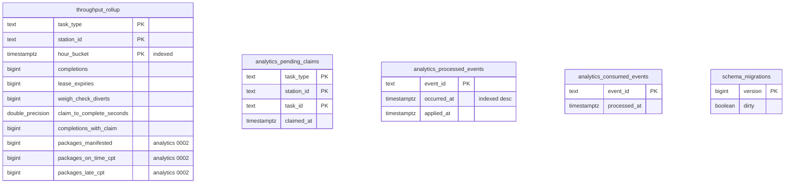

# Entity-relationship diagram

Two separate PostgreSQL databases, each migrated by golang-migrate at
startup:

- **OLTP** (`DATABASE_URL`, migrated over `MIGRATIONS_DATABASE_URL` when
  set — [ADR-0031](../adr/0031-migrations-direct-postgres-connection.md))
  — `migrations/0001` to `0024`, applied by `cmd/execution`.
- **Analytics** (`ANALYTICS_DATABASE_URL`) — `migrations/analytics/0001`
  and `0002`, applied by `cmd/fulfillment-projector` and read by
  `cmd/fulfillment-reports` ([ADR-0012](../adr/0012-analytical-data-product.md)).

Without `DATABASE_URL`, `cmd/execution` runs on the in-memory adapters and
none of this exists.

**There is not a single `FOREIGN KEY` in either schema**, so the diagrams
draw no relationship lines. The logical links are explained below the
diagrams — each one crosses an aggregate boundary, which is exactly why it
is held by id and not by a constraint.

## OLTP schema (final, after 0024)

```mermaid
erDiagram
    tasks {
        text id PK
        text task_type "PICK, PACK, SLAM, REBIN, DISPATCH, ARRIVAL, RELOCATE, REPLENISH, BREAK_CASE"
        text status "PENDING, CLAIMED, COMPLETED"
        timestamptz cpt
        text order_ref "indexed"
        text_array required_capabilities
        text lease_station_id "nullable"
        timestamptz lease_expiry "nullable"
        boolean fragile "0003"
        boolean gift_wrap "0005"
        timestamptz claimed_at "0007, nullable"
        text transfer_ref "0014, nullable - present means transfer work"
        text demand_id "0014, nullable"
        text work_kind "0014, nullable - TRANSFER_PICK|TRANSFER_DISPATCH|TRANSFER_ARRIVAL"
        text site_id "0014, nullable"
        text sku "0014, nullable"
        integer quantity "0014, nullable"
        text source_order_id "0016, nullable - order id from WorkReleased.ref, order work only"
        integer source_line_no "0017, nullable - order line from WorkReleased.line_no, order work only"
        text relocation_plan_id "0019, nullable - present means RELOCATE work"
        integer relocation_move_seq "0019, nullable"
        text relocation_kind "0019, nullable - Relocate|Assign|Vacate"
        text relocation_sku "0019, nullable"
        text relocation_from_bin "0019, nullable - NULL for an Assign"
        text relocation_to_bin "0019, nullable - NULL for a Vacate"
        integer relocated_quantity "0019, nullable - set on completion"
        text relocated_from_bin "0019, nullable - set on completion"
        text relocated_to_bin "0019, nullable - set on completion"
        text replenishment_request_id "0020, nullable - present means REPLENISH work"
        text replenishment_sku "0020, nullable"
        text replenishment_from_bin "0020, nullable"
        text replenishment_to_bin "0020, nullable"
        integer replenishment_quantity "0020, nullable - planned units"
        text replenishment_priority "0020, nullable - NORMAL|URGENT"
        integer replenished_quantity "0020, nullable - set on completion"
        text replenished_from_bin "0020, nullable - set on completion"
        text replenished_to_bin "0020, nullable - set on completion"
        text pick_sku "0023, nullable - PICK pick plan"
        integer pick_quantity "0023, nullable - planned eaches"
        text pick_unit "0023, nullable - EACH or CASE scan unit"
        text pick_from_bin "0023, nullable"
        integer picked_eaches "0023, nullable - confirmed by scans"
        text break_lpn "0023, nullable - BREAK_CASE sealed case"
        text break_sku "0023, nullable"
        text break_loose_bin "0023, nullable"
        text break_pick_task_id "0023, nullable - the EACH pick that found only the case"
    }
    stations {
        text id PK
        text_array capabilities
        text occupant "nullable"
        text location_code "0010, nullable"
    }
    packages {
        text id PK
        text order_ref "indexed, 0013"
        text status "OPEN, SEALED, LABELED, DIVERTED"
        text_array scanned_contents
        boolean fragile_handling "0003"
        integer_array scanned_hazard_classes "0004"
        boolean gift_wrap_requested "0005"
        text task_id UK "0011, partial unique where not null"
        text container_source "0024, nullable - CASE means ship-in-own-container"
        text container_gtin "0024, nullable - 14-digit, copied at seal time"
        integer container_length_mm "0024, nullable"
        integer container_width_mm "0024, nullable"
        integer container_height_mm "0024, nullable"
        integer container_weight_g "0024, nullable"
    }
    order_consolidations {
        text order_ref PK
        text_array required_lines
        text_array arrived_lines
    }
    product_classification_copy {
        text sku PK
        text_array handling_tags
        text temperature_class "0015, nullable"
        integer dot_hazard_class "0015, nullable, 1-9"
        bigint version "producer aggregate version"
        timestamptz updated_at
    }
    interleaving_hints {
        text station_id PK "one ACTIVE hint per station, 0021"
        text hint_id
        text site_id
        timestamptz expires_at
        jsonb candidates "ranked rank/task_id list"
        timestamptz received_at
    }
    pack_view {
        text gtin PK "14-digit, 0022"
        text sku "indexed with level"
        text level "EACH, INNER, CASE, PALLET"
        integer units_per_pack
        text child_gtin "nullable, 14-digit"
        bigint version "producer aggregate version"
        timestamptz effective_from
        timestamptz effective_to "nullable - retired level stays resolvable"
        timestamptz updated_at
        integer length_mm "0024, nullable - declared dims set together or not at all"
        integer width_mm "0024, nullable"
        integer height_mm "0024, nullable"
        integer weight_g "0024, nullable"
    }
    outbox_events {
        bigserial id PK
        text topic
        text event_type
        bytea key
        bytea value
        jsonb headers
        timestamptz created_at
        timestamptz published_at "nullable, partial index where null"
        integer attempts
        text last_error
    }
    processed_events {
        text event_id PK "CloudEvents id"
        timestamptz processed_at
    }
    idempotency_keys {
        text key PK
        text method
        text path
        text request_hash
        integer status_code
        bytea response_body
        jsonb response_headers
        timestamptz created_at "indexed"
        timestamptz completed_at
    }
    schema_migrations {
        bigint version PK
        boolean dirty
    }
```

Source: `migrations/0001_init.up.sql` to `migrations/0024_pack_view_dims_package_container.up.sql`,
applied in order; `0018_drop_domain_events` removed the legacy `domain_events` table
([ADR-0045](../adr/0045-drop-legacy-domain-events-table.md)); `schema_migrations` is golang-migrate's own table
(`internal/adapters/outbound/postgres/migrate.go`). Array columns are shown
as `text_array` / `integer_array` (Postgres `TEXT[]` / `INTEGER[]`).
Omits indexes other than the ones noted (`idx_tasks_type_status_cpt` on
`task_type, status, cpt` drives `FindClaimableByType`) and column defaults.

## Analytics schema (final, after analytics 0002)

Source: `migrations/analytics/0001_report.up.sql`,
`migrations/analytics/0002_on_time_to_cpt.up.sql`,
`internal/adapters/outbound/analyticsstore/*.go`. Omits column defaults.

## Logical links without a foreign key

| From | To | Why there is no FK |
| --- | --- | --- |
| `packages.task_id` | `tasks.id` | `Package` and `Task` are separate aggregates; `SealPackage` checks the task in the application layer. The partial unique index enforces one package per PACK task. |
| `tasks.lease_station_id` | `stations.id` | The lease names its owner by id; a station can be re-registered without touching tasks. |
| `tasks.order_ref`, `packages.order_ref`, `order_consolidations.order_ref` | upstream `work_unit_id` | Not a table here at all — an opaque id from `wes-work-planning`. |
| `product_classification_copy.sku`, `pack_view.gtin` / `.sku` | product-master | Local copies fed by `ProductClassified` and `ProductPackLevelDeclared` / `ProductPackLevelRetired` events ([ADR-0039](../adr/0039-product-classification-local-copy.md), [ADR-0054](../adr/0054-case-and-each-pick-scans-and-break-case-task.md)); the producer owns the keys. |
| `interleaving_hints.station_id` | `stations.id` | Local copy of task-interleaving's advisory hint ([ADR-0051](../adr/0051-interleaving-hints-advise-claimnext.md)); fail-open — an absent or expired row means "no hint", so no constraint. |
| `throughput_rollup`, `analytics_pending_claims` | `tasks`, `stations` | Different database; built only from events. |

## Table ≠ aggregate

| Table | Aggregate / role | Kind |
| --- | --- | --- |
| `tasks` | `task.Task` (the `Lease` value object is flattened into `lease_station_id` + `lease_expiry`) | aggregate |
| `stations` | `station.Station` | aggregate |
| `packages` | `pack.Package` | aggregate |
| `order_consolidations` | `consolidation.OrderConsolidation` | aggregate |
| `product_classification_copy` | local copy of product-master's classifications, read by `SealPackage`'s `ProductClassificationLookup` ([ADR-0039](../adr/0039-product-classification-local-copy.md)) | local copy |
| `interleaving_hints` | local copy of task-interleaving's advisory hints, read by `claimNext` as a tie-break ([ADR-0051](../adr/0051-interleaving-hints-advise-claimnext.md)) | local copy |
| `pack_view` | local copy of product-master's pack levels keyed by GTIN, read by the pick scan confirmation ([ADR-0054](../adr/0054-case-and-each-pick-scans-and-break-case-task.md)); declared dims and the package container columns come from ship-in-own-container ([ADR-0056](../adr/0056-ship-in-own-container.md)) | local copy |
| `outbox_events` | transactional outbox, drained by the relay in `cmd/execution` ([ADR-0020](../adr/0020-transactional-outbox.md)) | infrastructure |
| `processed_events` | inbox dedupe for the `WorkReleased` consumer (`ports.ProcessedEvents`) | infrastructure |
| `idempotency_keys` | `Idempotency-Key` replay store for `POST /tasks` ([ADR-0028](../adr/0028-idempotency-key-middleware.md)) | infrastructure |
| `schema_migrations` | golang-migrate version table (one per database) | infrastructure |
| `throughput_rollup` | throughput and on-time-to-CPT projection ([ADR-0026](../adr/0026-on-time-to-cpt-kpi.md)) | analytics projection |
| `analytics_pending_claims` | claim times waiting for a completion | analytics projection state |
| `analytics_processed_events` | projection idempotency and freshness | analytics infrastructure |
| `analytics_consumed_events` | consumer-level dedupe for the analytics consumer | analytics infrastructure |
