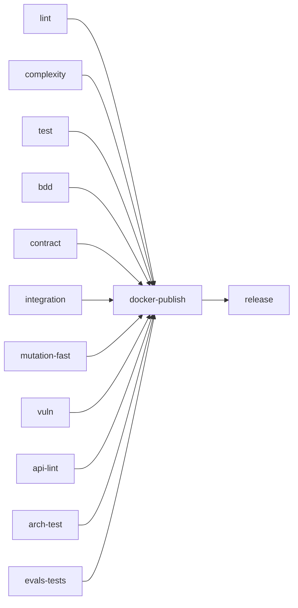

# Testing

Every layer below is runnable locally through the `Makefile`, and every
`make` target mirrors a job in `.github/workflows/ci.yml`. Numbers on this
page were counted from the repository at the time of writing.

## The layers

| Layer | What it covers | Where | Needs | Run it |
| --- | --- | --- | --- | --- |
| Unit | Aggregates and invariants (`internal/domain/**`), use cases with fakes and in-memory adapters (`internal/application/usecases`), adapters with `httptest` and fake readers/writers (HTTP handlers, Kafka encode/decode, golden CloudEvents JSON, MCP tools). 92 non-integration `_test.go` files. | next to the code | Go only | `make test` (`go test ./... -race`) |
| Coverage gate | Statement coverage of `internal/domain/...` and `internal/application/...` must be **≥ 90%**. | – | Go | `make coverage` |
| Integration | Real Postgres and Kafka started per test run with **testcontainers-go** (`modules/postgres`, `modules/kafka`); no `DATABASE_URL`, no compose. 24 files tagged `//go:build integration`. | see the list below | Docker | `make integration` (`go test -tags=integration ./... -race -count=1`) |
| BDD (Gherkin) | Business rules as black-box scenarios: the real chi router behind `httptest`, in-memory repositories, a buffered publisher and a fixed clock ([ADR-0007](../adr/0007-godog-bdd-acceptance-tests.md)). | `features/*.feature`, run by `TestFeatures` in `features_test.go` | Go | `make bdd` (`go test ./... -run TestFeatures -v`) |
| Contract | Property-based conformance of the running API to `apis/openapi.yaml` (Schemathesis 4.28.0). | `scripts/contract-test.sh`, `schemathesis.toml` | Go, Python `st` | `make contract` |
| Mutation | Do the tests assert, not just execute? gremlins v0.6.0 with thresholds from `.gremlins.yaml`. | `.gremlins.yaml` | `gremlins` | `make mutation-fast`, `make mutation` |
| Architecture fitness | The hexagonal dependency rule and fleet rules as Go tests ([ADR-0006](../adr/0006-arch-go-architecture-fitness-tests.md)). | `internal/architecture/` | Go | `make arch-test` |
| MCP evals | E1 schema/metadata, E2 wire conformance, E3 behavioural Gherkin over the Streamable HTTP handler. | `internal/adapters/inbound/mcp/eval_*_test.go`, `evalsuite_test.go`, `testdata/features/mcp_tools.feature` | Go | `go test ./internal/adapters/inbound/mcp/... -race -run '^TestEval\|^TestMCPEvalSuite' -v` |
| Chart render tests | Probes, MCP env, Service selectors and sweep CronJobs render as intended; the api Deployment mounts the env ConfigMap with `envFrom` (D14) and `OUTBOX_MAX_ATTEMPTS` defaults to 20 (D12), no other workload mounts it. | `charts/fulfillment-execution/tests/*.py`, `charts/fulfillment-execution/tests/render_test.sh` | Python (PyYAML), bash, `helm` | `bash charts/fulfillment-execution/tests/render_test.sh`, `python3 charts/fulfillment-execution/tests/test_sweeps_cronjob.py` (one script per file); all four run in the `chart-tests` CI job |
| Frontend | The `web/` micro-frontend: lint, type check, unit tests, build. | `web/` | Node 22 | `npm test` in `web/` |

### Integration suites

All tagged `integration`. Each package starts its own containers; the
`postgres` and `inbound/http` packages share one migrated Postgres per
package run through `main_integration_test.go`:

- `internal/adapters/outbound/postgres`: repositories, the claim
  compare-and-set race, the consolidation race, the outbox and relay, pool
  limits and `statement_timeout`, rehydration validation, source order and
  line number, transfer details, the RELOCATE move and its executed result
  (`task_relocation_integration_test.go`, migration 0019) and the REPLENISH move
  and its executed result (`task_replenishment_integration_test.go`, migration
  0020, with its down).
- `internal/adapters/inbound/http`: the `Idempotency-Key` middleware against
  a real transaction.
- `internal/adapters/inbound/kafka`: the DLQ, the `ProductClassified`
  consumer, `line_no` bounds, transfer facts end to end (Kafka + Postgres),
  and a RELOCATE release completed into a `TaskCompleted` with the
  relocation fields end to end (`relocation_integration_test.go`,
  ADR-0047), and a REPLENISH release completed into a `TaskCompleted` with
  `request_ref` end to end, with the atomicity of creation and completion
  (`replenishment_integration_test.go`, ADR-0050).
- `internal/adapters/outbound/kafka`: hash partitioning by aggregate key and
  CloudEvents on the wire.
- `internal/adapters/outbound/kafkacatalog`: catalogue replay against a real
  broker.
- `internal/adapters/outbound/analyticsstore`: projection and read-only
  report store.
- `internal/adapters/outbound/productclassificationcopy`: the
  version-guarded upsert.
- `internal/adapters/inbound/mcp`: the Streamable HTTP transport over
  Postgres.
- `internal/application/usecases`: use cases wired to real adapters.
- `cmd/mcp`: `complete_task` writing the outbox.

`make integration` and the CI `integration` job both run
`go test -tags=integration ./...`, so a new suite is picked up without
editing either. The fitness tests `TestKafkaIntegrationTestsUseTestcontainers`
and `TestPostgresIntegrationTestsUseTestcontainers` fail the build if a test
gates on an external `KAFKA_BROKERS` or `DATABASE_URL` instead of starting a
container.

### BDD features

21 feature files with 92 `Scenario`/`Scenario Outline` headings (6 are
outlines, expanded by their example tables):

| Feature file | Scenarios |
| --- | --- |
| `claim_next.feature` | 3 |
| `claim_next_validation.feature` | 3 |
| `complete_task.feature` | 2 |
| `cpt_missed_sweep.feature` | 4 |
| `cpt_sweep_boundaries.feature` | 2 |
| `installed_capacity.feature` | 2 |
| `lease.feature` | 2 |
| `order_ref_lookup.feature` | 3 |
| `pack_slam.feature` | 4 |
| `package_read_model.feature` | 6 |
| `rebin_consolidation.feature` | 6 |
| `request_validation.feature` | 17 (5 outlines) |
| `seal_package_guards.feature` | 4 |
| `slam_required_weights.feature` | 4 |
| `slam_tolerance.feature` | 1 |
| `station_and_claim_selection.feature` | 3 |
| `station_occupancy.feature` | 4 |
| `task_creation.feature` | 2 |
| `task_guards.feature` | 6 |
| `task_lifecycle_edges.feature` | 9 |
| `work_released_consumer.feature` | 5 (1 outline) |

The MCP E3 suite adds 17 scenarios in
`internal/adapters/inbound/mcp/testdata/features/mcp_tools.feature`. The
fixed clock is what lets a scenario assert lease expiry without sleeping.

### Contract tests

`scripts/contract-test.sh` builds `cmd/execution`, writes a four-path
catalogue (`PICK`, `PACK`, `REBIN`, `SLAM`) to a temp dir, boots the service
in memory on `127.0.0.1:18082` (override with `CONTRACT_PORT`), waits for
`/healthz`, then runs `st run apis/openapi.yaml --max-examples 100 --workers 4`
(`CONTRACT_MAX_EXAMPLES` overrides the count). `sealPackage` is excluded,
because success needs a PACK task claimed by the same station, which OpenAPI
cannot express; `schemathesis.toml` widens accepted statuses for
`arriveAtRebin` only (a `422 rebin-unknown-line` on a schema-valid body).
Install with `python3 -m pip install 'schemathesis==4.28.0'`.

### Mutation testing

| Target | Scope | When | Gate |
| --- | --- | --- | --- |
| `make mutation-fast` / CI `mutation-fast` | `./internal/domain/task` (claim, lease, at-most-once, CPT-missed) | every push and PR | efficacy ≥ 90%, mutant coverage ≥ 90% |
| `make mutation` / CI `mutation` | `./internal/domain` (`--workers 1 --timeout-coefficient 30`) | weekly schedule and manual dispatch | same thresholds |

The thresholds live in `.gremlins.yaml` (`threshold.efficacy: 90.0`,
`threshold.mutant-coverage: 90.0`).

### Architecture fitness tests

`internal/architecture/` (`make arch-test`):

| Test | Guards |
| --- | --- |
| `TestHexagonalDependencyRules` | domain imports nothing internal but domain; application only domain; inbound and outbound adapters never import each other; only `cmd` wires everything |
| `TestAnalyticsIsolationRules` | `internal/analytics/**` imports nothing else from the module, and domain/application never import it ([ADR-0012](../adr/0012-analytical-data-product.md)) |
| `TestMCPAdapterDependencyRule` | the MCP adapter depends only on application and domain, and nothing depends on it |
| `TestRepositoryPortImplementersFollowRepoNamingConvention` | every struct implementing the `TaskRepo` port is named `...Repo` |
| `TestEventCatalogueMatchesContract`, `TestEventCatalogueDetector` | the published CloudEvents types match `apis/asyncapi.yaml` |
| `TestCloudEventsOnly` | no flat-envelope code path comes back ([ADR-0032](../adr/0032-cloudevents-mandatory-envelope.md)) |
| `TestReplayConsumersSetCommitInterval` | full-replay consumers commit asynchronously |
| `TestNoAuthMiddlewareReintroduced` | REST/MCP stay unauthenticated ([ADR-0022](../adr/0022-remove-rest-mcp-auth.md)) |
| `TestKafkaConsumerGroupNeverHardcodedInline` | no Kafka `GroupID` is assigned from an inline string literal (it must come from a named constant, an env lookup or a function) |
| `TestKafkaIntegrationTestsUseTestcontainers`, `TestPostgresIntegrationTestsUseTestcontainers`, `TestPostgresIntegrationDetector` | integration tests start their own containers |
| `TestMCPOptionalToolInputsCarryOmitempty`, `TestMCPOptionalToolInputsSensorFailsOnBadFixtures` | an MCP tool input field whose `jsonschema` description says "optional" carries `omitempty`, or the SDK marks it required (gap fix D16; the twin proves the sensor fails on a bad fixture) |
| `TestOutboxRelaysPassAttemptCap`, `TestOutboxRelayCapSensorFailsOnBadFixtures` | every `NewOutboxRelay` call under `cmd/` or `internal/composition/` passes `WithMaxAttempts` ([ADR-0042](../adr/0042-outbox-relay-attempt-cap.md), gap fix D12) |
| `TestKafkaWritersSetRequiredAcks`, `TestKafkaWriterAcksSensorBites` | Every kafka-go `Writer` composite literal in a non-test file under `internal/` or `cmd/` sets `RequiredAcks` (the import alias is resolved per file). kafka-go defaults it to `RequireNone` (acks=0): the broker never confirms the write, so a broker blip silently drops the message while `WriteMessages` returns nil. The twin proves the sensor flags a bad fixture under any alias. |
| `TestDeadLetterCallsGuardCancellation` (+ `TestDeadLetterShutdownSensorBites`, `kafka_dlq_shutdown_fitness_test.go`) | Every function in a non-test file under `internal/adapters/inbound/kafka` that sends to the dead-letter topic must reference `ctx.Err()` (any context-named value) or `context.Canceled` in its own body, or carry a `//dlq:deterministic <reason>` comment on the call line or the line above it. A handler that fails because the process is stopping must not dead-letter a good message and commit past it (network-fulfillment #89); a guard in the caller does not count. The sensor test proves the detector flags the pre-fix shape. |
| `TestKafkaWriterTopicNotSetTwice` (+ `TestKafkaWriterTopicSensorBites`, `kafka_writer_topic_fitness_test.go`) | kafka-go rejects every write whose `Message.Topic` is set when the `Writer` also has a `Topic`. Per Go package under `internal/` and `cmd/`: once any kafka-go `Message` literal sets `Topic`, every `Writer` literal in that package must leave `Topic` empty, unless it carries `//kafka:fixed-topic-writer <reason>` and no Topic-setting Message is provably written through it. Writers configured after construction and `WriterConfig` are not covered. (Escape: warehouse-planning's domain DLQ writer, where no dead letter ever landed.) |

Gap-fix wave (2026-10-12) tests outside `internal/architecture`:

| Test | Guards |
| --- | --- |
| `TestEvalConformance_InstructionsNameTheWriteTool` | the MCP `instructions` do not call the server read-only and name `complete_task` (D17) |
| `TestReportTools_OptionalFiltersAreOptionalOnTheWire` | both report tools advertise `required: [from, to]` and a call without filters reaches the handler (D16) |
| `TestNewLoggerLevels` (one per `cmd/*`) | `LOG_LEVEL` `warn`/`warning`, case-insensitive, in every binary (D22) |
| `TestOutboxRelay_MaxAttempts_PoisonRowExcludedThenGoodRowPublishes`, `TestOutboxRelay_MaxAttempts_ReArmedRowIsClaimedAgain`, `TestOutboxRelay_NoCap_PoisonRowBlocksLaterRows` (integration, testcontainers) | the relay attempt cap: a poison row is excluded after N failures and logged at ERROR, the same-key row behind it publishes, the re-arm SQL works, `0` keeps the old blocking behaviour (D12) |
| `TestOutboxTrace_TraceparentCrossesTheOutboxToKafka`, `TestOutboxTrace_RowWithoutTraceHeadersRelaysUnchanged` (integration, testcontainers Postgres + Kafka) | the request span's `traceparent` is stored in `outbox_events.headers`, relayed by a span-less relay pass to a real broker and extracted by a consumer as the same parent; a row without trace headers relays unchanged (D27; characterisation tests, the behaviour already existed) |
| `TestReportsSpecAndRouterAgree`, `TestReportsResponsesConformToSpec` | `apis/openapi-reports.yaml` and `NewReportsRouter` agree on routes (both directions), statuses, media types and properties (D18, [ADR-0043](../adr/0043-reports-api-openapi-contract.md)) |
| `TestOutboxMaxAttempts`, `TestBuildEventPublisher_KafkaWithPoolUsesOutbox` | `OUTBOX_MAX_ATTEMPTS` parsing (default 20, 0 unlimited, bad value falls back) and the cap reaching the relay (D12) |

## Local gates and hooks

| Target | Runs |
| --- | --- |
| `make check` | `fmt-check vet build lint test`: the fast bundle |
| `make check-all` | `check` + `coverage arch-test bdd`: the fuller gate |
| `make check-fast` | `fmt-check vet arch-test` plus tests of the Go packages changed vs `HEAD` (agent stop hook) |
| `make vuln` | `govulncheck ./...` |
| `make guide-lint`, `make harness-test` | agent-guide lint and hook tests |

`lefthook.yml` (activate once with `lefthook install`): **pre-commit** runs
`make fmt-check`, `make vet`, `make lint`; **pre-push** runs `make check`.
golangci-lint is pinned to `v2.13.1`.

## CI jobs (`.github/workflows/ci.yml`)

Triggers: push and pull request to `main` and `develop`, a weekly schedule
(Monday 06:00 UTC) and manual dispatch.

| Job | Runs | When |
| --- | --- | --- |
| `lint` | golangci-lint v2.13.1 | every push/PR |
| `guide-lint` | `scripts/harness/guide_lint.py`, `repo_lint.py`, `test_hook.py`, `test_repo_lint.py` | every push/PR |
| `complexity` | golangci-lint with only `gocyclo,gocognit,cyclop,funlen,nestif`, plus an informational gocyclo report | every push/PR |
| `test` | build, vet, then `make coverage` (`go test ./... -race` with the Makefile's coverage scope and 90% gate) | every push/PR |
| `bdd` | `go test ./... -run TestFeatures -v` | every push/PR |
| `contract` | `scripts/contract-test.sh` with Schemathesis 4.28.0 | every push/PR |
| `evals-tests` | MCP evals (`^TestEval` and `^TestMCPEvalSuite`) | every push/PR |
| `integration` | `go test -tags=integration ./... -race -count=1` | every push/PR |
| `mutation-fast` | `gremlins unleash ./internal/domain/task` | every push/PR |
| `vuln` | govulncheck v1.8.0 | every push/PR |
| `api-lint` | Spectral on `apis/openapi.yaml`, `apis/openapi-reports.yaml` and `apis/asyncapi.yaml` | every push/PR |
| `docs-api-drift` | `npm run clean-api-docs:all && npm run gen-api-docs:all` in `docs/`, fail on a diff or an untracked page under `docs/api-reference/rest` or `docs/api-reference/rest-reports` | every push/PR |
| `arch-test` | `go test ./internal/architecture/... -v` | every push/PR |
| `web` | builds warehouse-ui-kit `develop`, then lint, `tsc -b`, `npm test`, build of `web/` | every push/PR |
| `mutation` | full domain mutation run; opens/closes a `harness:red` issue | schedule and dispatch only |
| `drift` | deadcode, `go mod tidy -diff`, knip on `web/`, coverage-quality report (advisory) | schedule and dispatch only |
| `helm-lint` | chart-testing lint | pull requests into `main` only |
| `chart-tests` | `bash charts/fulfillment-execution/tests/render_test.sh`, then the three Python chart tests with PyYAML 6.0.3 pinned (so they cannot `SKIP`) | every push/PR (gap fix D25) |
| `trivy-scan` | image build plus Trivy (blocks on fixable CRITICAL/HIGH) | pull requests into `main` only |
| `docker-publish` | build, push, cosign sign, SBOM attest | push to `main` only |
| `release` | version tag, Helm chart push to `oci://ghcr.io/iqvo`, GitHub release | push to `main` only |

Other workflows: `codeql.yml` (push/PR to `main` and `develop`, weekly),
`scorecard.yml` (push to `develop`, weekly), `ai-review.yml` (PRs into
`develop` touching domain, application, `apis/` or `charts/`), and
`docs.yml`, which builds the site (`npm run typecheck`, `npm run build`) on
every pull request touching `docs/**` and deploys it **only on push to
`main`** (the PR trigger is gap fix D25; before it, a broken sidebar id or
link was found only after release).

Source: `.github/workflows/ci.yml` (`docker-publish.needs`, `release.needs`).
