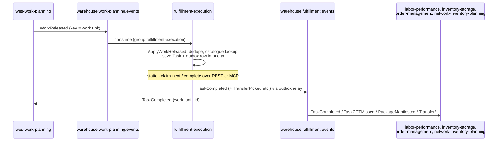

# Integration contracts

The operational detail behind the Kafka and HTTP edges on the
[Context map](./context-map.md). Everything here is taken from the adapter
code on `develop` and from the consumers' own code, not from intent.

## Topic summary

| Direction | Topic | Event | Adapter | Consumer group |
| --- | --- | --- | --- | --- |
| Consume | `warehouse.work-planning.events` | `WorkReleased` | `internal/adapters/inbound/kafka/consumer.go` | `WORK_RELEASED_CONSUMER_GROUP` (default `fulfillment-execution`); a new group starts at the **latest** offset |
| Consume (opt-in) | `warehouse.product-master.events` | `ProductClassified` | `internal/adapters/inbound/kafka/product_classified_consumer.go`, only when `PRODUCT_CLASSIFICATION_MODE=kafka` | `PRODUCT_CLASSIFICATION_CONSUMER_GROUP` (no default; required) |
| Consume (opt-in) | `warehouse.process-path-management.events` | process-path catalogue events | `internal/adapters/outbound/kafkacatalog`, only when `PATH_CATALOGUE_SOURCE=kafka` | a fresh group per process: full replay on every boot |
| Publish | `warehouse.fulfillment.events` | `TaskCompleted`, `TaskCPTMissed`, `PackageManifested`, `TransferPicked`, `TransferDispatched`, `TransferArrived` | `internal/adapters/outbound/kafka/publisher.go` | – |
| Publish | `warehouse.work-planning.events.dlq` | failed / poison `WorkReleased` | `consumer.go` (`DeadLetterTopic`), only when `EVENT_PUBLISHER=kafka` | – |
| Publish + consume | `warehouse.fulfillment.analytics` | `TaskCreated`, `TaskClaimed`, `LeaseExpired`, `TaskCompleted`, `ItemPicked`, `PackageSealed`, `WeightDiscrepancyDetected`, `LabelApplied`, `PackageDiverted`, `PackageManifested` ([ADR-0012](../adr/0012-analytical-data-product.md)) | `outbound/kafka/analytics_publisher.go` → `inbound/kafka/analytics_consumer.go` (projector) | `fulfillment-analytics` (constant) |

The projector applies five of the ten analytics types (`TaskClaimed`,
`TaskCompleted`, `LeaseExpired`, `WeightDiscrepancyDetected`,
`PackageManifested`) and ignores the rest.

## Who depends on this service

Found by searching the sibling repositories' `develop` branches for this
service's topics, CloudEvents types, base URL and MCP endpoint. No other
repository consumes `warehouse.fulfillment.analytics`.

| Consumer | Edge | What it uses | Where (in that repo) |
| --- | --- | --- | --- |
| wes-work-planning | Kafka `warehouse.fulfillment.events` | `TaskCompleted` (`work_unit_id`) to record completion of the work unit | `internal/adapters/inbound/kafka/consumer.go`, `usecases/apply_task_completed.go` |
| labor-performance | Kafka `warehouse.fulfillment.events`, group `KAFKA_CONSUMER_GROUP` (default `labor-performance`) | `TaskCompleted` (`associate_id`, `duration_seconds`, `task_type`) | `internal/adapters/inbound/kafka/consumer.go`, `cmd/labor/main.go` |
| inventory-storage | Kafka `warehouse.fulfillment.events`, group `inventory-storage-confirm-pick` | `TaskCompleted` of PICK tasks, counted per order to confirm picked reservations | `internal/adapters/inbound/kafka/task_completed_consumer.go` |
| order-management | Kafka `warehouse.fulfillment.events`, group `order-management-repromise` | `TaskCPTMissed` and `PackageManifested` (re-promise loop) | `internal/adapters/inbound/kafka/repromise_consumer.go` |
| network-inventory-planning | Kafka `warehouse.fulfillment.events` | `TransferPicked`, `TransferDispatched`, `TransferArrived` (transfer saga) | `internal/adapters/inbound/kafka/transfer_fact_consumer.go` |
| workforce-management | REST `GET /capacity/{capability}` behind a circuit breaker, base URL `FULFILLMENT_EXECUTION_BASE_URL`, `INSTALLED_CAPACITY_MODE` | installed station count when committing a shift plan | `internal/adapters/outbound/fulfillmentexecution/client.go`, `cmd/workforce/main.go` |
| warehouse-ops-agent | MCP (`FULFILLMENT_EXECUTION_MCP_ENDPOINT`) and REST (`FULFILLMENT_EXECUTION_REST_URL`, `FULFILLMENT_EXECUTION_REPORTS_REST_URL`) | the [MCP tools](../mcp/tools.md) and the REST API | `internal/config/config.go` |
| warehouse-console | REST through Kong at `/api/fulfillment-execution` | the throughput report on its context-reports screen | `src/config.ts`, `src/features/context-reports/fulfillmentExecution.config.tsx` |
| e2e-tests | Kafka and REST | end-to-end scenarios | `e2e_test.go`, `transfer_test.go` |

`GET /capacity/{capability}` matches the registered capability string
exactly, so `GET /capacity/PICK` returns `0` when stations registered `pick`.



Source: `internal/adapters/inbound/kafka/consumer.go`,
`internal/application/usecases/consume_work_released.go`,
`internal/adapters/outbound/postgres/outbox_relay.go`, and the consumer files listed
in the table above.

## Outbound HTTP

| Dependency | Call | When | Failure behaviour |
| --- | --- | --- | --- |
| facility-layout | `GET {FACILITY_LAYOUT_BASE_URL}/locations/{locationCode}` | `RegisterStation`, only with `LOCATION_ROLE_MODE=http` | Behind a circuit breaker (`internal/adapters/outbound/facilitylayout`); an error or open breaker yields "role unknown", which is accepted ([ADR-0024](../adr/0024-station-location-code-and-workcenter-role-check.md)). |
| fulfillment-reports (own service) | `GET {REPORTS_BASE_URL}/reports/throughput` | MCP report tools, only with `REPORTS_BASE_URL` | The tool returns an error result. |

## Inbound: `ProductClassified`

Only with `PRODUCT_CLASSIFICATION_MODE=kafka`
([ADR-0039](../adr/0039-product-classification-local-copy.md)). The consumer
dispatches on the full type
`com.warehouse.wms.product-master.product.ProductClassified` (key and
`subject` = the SKU) and ignores every other type on the topic. Each event is
a full-state replacement of one SKU's classification (`sku`,
`handling_tags`, `temperature_class`, `dot_hazard_class`,
`classification_source`, `version`) and is upserted into
`product_classification_copy` with a version guard, so an older event never
overwrites a newer one. `SealPackage` reads the hazard class from that copy
for the segregation check. A payload that breaks the contract (missing
`sku`, `version < 1`, `dot_hazard_class` outside 1–9) is logged and
committed past; any other failure retries the same message with backoff
(200ms to 5s) until it succeeds, so it blocks its partition but never loses
an event.

Every message on every one of these topics is a **CloudEvents 1.0** event in
structured content mode, built and validated with the official
`sdk-go/v2/event` package via `internal/adapters/kafka/cloudevents`, and every
produced message carries `content-type: application/cloudevents+json;
charset=UTF-8` ([ADR-0032](../adr/0032-cloudevents-mandatory-envelope.md)).
There is no flat envelope and no envelope toggle.

Client library on both sides: `github.com/segmentio/kafka-go` (pure Go, no
cgo). Broker list comes from `KAFKA_BROKERS`, default `localhost:9092`.

A shared broker for the whole platform runs in the `warehouse-infra` kind
cluster, exposed on the host at `localhost:9092`. This repo's own
`docker-compose.yml` deliberately defines **only Postgres** — adding a second
broker would fragment the platform's integration testing.

## Inbound: `WorkReleased`

### Envelope

A CloudEvents 1.0 event; this consumer dispatches on the full `type`
`com.warehouse.wes.work-planning.workunit.WorkReleased` and ignores any other
type:

```json
{
  "specversion": "1.0",
  "id": "11111111-1111-4111-8111-111111111111",
  "source": "/warehouse/wes-work-planning",
  "type": "com.warehouse.wes.work-planning.workunit.WorkReleased",
  "subject": "wu-8a1f",
  "time": "2026-08-21T22:00:00Z",
  "datacontenttype": "application/json",
  "dataschema": "urn:warehouse:wes-work-planning:events:WorkReleased:v1",
  "data": {
    "path_id": "pick-zone-a",
    "work_unit_id": "wu-8a1f",
    "cpt": "2026-08-23T18:00:00Z",
    "ref": "order-4471",
    "fragile": false,
    "gift_wrap": false
  }
}
```

`fragile` and `gift_wrap` are optional packing hints (default `false`).
`line_no` is the optional 1-based order line the release is for
([ADR-0041](../adr/0041-task-completed-carries-line-no.md)); when it is absent
the task's line stays unknown and is never guessed from the work unit id.

### The translation (Anti-Corruption Layer)

| From | To | How |
| --- | --- | --- |
| `data.path_id` | `task.Type` | process-path catalogue lookup, longest `matchPrefix` wins — see below |
| `data.work_unit_id` | `shared.OrderRef` | direct |
| `data.cpt` | `shared.CPT` | RFC 3339 timestamp |
| *(from the matched path)* | `shared.CapabilitySet` | the path definition's `requiredCapabilities` |
| `data.fragile` / `data.gift_wrap` | `Task.Fragile` / `Task.GiftWrap` | direct, default `false` |
| `data.line_no` | `Task.SourceLineNo` | direct; republished as `line_no` on `TaskCompleted` |
| `data.ref` | — | decoded; becomes `demand_id` on a transfer fact |

The consumer then calls the **existing** `CreateTask` use case. No new use
case was introduced for the Kafka path — creating a task from released work
*is* what `CreateTask` is for, and giving the Kafka path its own parallel use
case would have meant two code paths that must stay in agreement.

:::info[path_id resolves through the process-path catalogue]
Since [ADR-0017](../adr/0017-process-path-catalogue-as-configuration.md) the consumer calls `PathCatalogue.Lookup(path_id)`:
the **longest** declared `matchPrefix` that prefixes the id (case-insensitive)
wins, and the matched definition supplies both the task type (its `id`, e.g.
`PICK`, `PACK`, `SLAM`, `REBIN`) and the required capabilities. A `path_id`
that matches nothing is a **hard error** — the message is not acked as a
silent Pick task, which is what the retired prefix-guessing code used to do.

The catalogue comes from `PATH_CATALOGUE_SOURCE`: `file` (default) loads
`PATH_CATALOGUE_FILE` once at boot; `kafka` replays
`warehouse.process-path-management.events` into memory and follows live
changes. The `warehouse-infra` kind cluster runs the `kafka` source; its
`config/process-paths/sortable-fc.yaml` is kept only as the rollback target
and as a handy file for local `go run`.
:::

### Idempotency

Kafka is at-least-once, so redelivery is expected, not exceptional. Before
creating anything, the consumer calls:

```go
isNew, err := c.Processed.MarkProcessed(ctx, env.EventId) // the CloudEvents id
if !isNew {
    return nil   // already applied by a prior delivery — ack anyway
}
```

`MarkProcessed` returns `true` **only** if this call newly recorded the id, so
the check-and-record is a single atomic operation rather than a
read-then-write race.

| Adapter | Mechanism |
| --- | --- |
| Postgres | `processed_events (event_id TEXT PRIMARY KEY, processed_at TIMESTAMPTZ)` — the column now stores the CloudEvents `id`; the primary-key constraint *is* the deduplication |
| Memory | mutex-guarded `map[string]struct{}` |

A unit test feeds the same `id` twice and asserts exactly one task exists.

### Failure handling

A message that fails handling after the in-process retries (ADR-0029: 3
attempts with jittered backoff) is published to
`warehouse.work-planning.events.dlq` with `x-dlq-*` failure headers, and the
loop continues. A message that is not a valid CloudEvents 1.0 event —
including the retired flat `event_id`/`event_type` envelope — is a
deterministic poison message: it is dead-lettered immediately, never retried
and never parsed any other way. The DLQ writer is wired only when
`EVENT_PUBLISHER=kafka`; otherwise the failure is only logged. Since
ADR-0036 the processed-event claim, the catalogue lookup and the task
creation commit in ONE UnitOfWork (`usecases.ApplyWorkReleased`), so a
failed create leaves no `processed_events` row — a replayed dead-lettered
message simply re-applies, no manual clearing needed. Only a message that
genuinely completed keeps its row.

Consumer group: `WORK_RELEASED_CONSUMER_GROUP`, default `fulfillment-execution`.

WorkReleased may carry an optional inter-warehouse-transfer correlation
block (`transfer_ref`, `work_kind`, `site_id`, `sku`, `quantity`); see
[ADR-0036](../adr/0036-transfer-task-types-and-facts.md). Its presence
turns the created task into transfer work whose completion publishes a
transfer fact; absence is exactly the pre-ADR-0036 behavior.

## Outbound: transfer facts (`TransferPicked` / `TransferDispatched` / `TransferArrived`)

When a task carrying a transfer correlation block completes, exactly ONE
fact is selected by `work_kind` and published on
`warehouse.fulfillment.events` alongside the unchanged `TaskCompleted`,
committing with the task's Completed state in the same outbox transaction:

| `work_kind` | fact |
| --- | --- |
| `TRANSFER_PICK` | `TransferPicked` |
| `TRANSFER_DISPATCH` | `TransferDispatched` |
| `TRANSFER_ARRIVAL` | `TransferArrived` |

Envelope: type `com.warehouse.wes.fulfillment-execution.transfer.<Fact>`,
dataschema `urn:warehouse:fulfillment-execution:events:<Fact>:v1`,
subject and Kafka key = the completing task id, `time` = the completion
time. Payload: `{transfer_ref, demand_id?, work_unit_id, task_id,
work_kind, site_id?, sku?, quantity?}` — `demand_id` is the release's own
`ref`. Non-transfer tasks never publish a transfer fact.

## Outbound: `TaskCompleted`

### Selection

The publisher is chosen at the composition root:

```go
if getenv("EVENT_PUBLISHER", "log") != "kafka" {
    return events.NewLogPublisher(logger), nil, func() {}
}
// with Postgres: encoders feed the transactional outbox (ADR-0020)
integration := outboundkafka.NewPublisherWithWriter(nil, tasks, stations, uuid.NewString)
analytics := outboundkafka.NewAnalyticsPublisherWithWriter(nil, tasks, uuid.NewString)
return postgres.NewOutboxPublisher(pool, integration, analytics), relay, ...
```

Both satisfy `ports.EventPublisher`, so **no use case knows which one it
got** — the default stays `log` so tests and local runs need no broker.

### Envelope on the wire

```json
{
  "specversion": "1.0",
  "id": "6f1c2a3b-4d5e-4f60-8a7b-9c0d1e2f3a4b",
  "source": "/warehouse/fulfillment-execution",
  "type": "com.warehouse.wes.fulfillment-execution.task.TaskCompleted",
  "subject": "task-8a1f",
  "time": "2026-08-22T14:04:00Z",
  "datacontenttype": "application/json",
  "dataschema": "urn:warehouse:fulfillment-execution:events:TaskCompleted:v1",
  "data": {
    "task_id": "task-8a1f",
    "station_id": "station-03",
    "work_unit_id": "wu-8a1f",
    "associate_id": "worker-42",
    "duration_seconds": 245,
    "task_type": "PICK",
    "order_ref": "order-4471",
    "line_no": 2
  }
}
```

`associate_id`, `duration_seconds`, `task_type`, `order_ref` and `line_no`
are omitted when empty (`omitempty` on `TaskCompletedData`); `order_ref` and
`line_no` were added by [ADR-0040](../adr/0040-task-completed-carries-order-ref.md)
and [ADR-0041](../adr/0041-task-completed-carries-line-no.md) so
inventory-storage can confirm the reservation of one order line.

Message key (and CloudEvents `subject`): the task id, so all events for one
task land on the same partition and preserve order. The `id` is a UUID v4
minted once at encode time and stored in the outbox row, so a relay retry
republishes the same `id`.

### The enrichment

`TaskCompleted` as a domain event carries only `TaskId` and `StationId`. The
publisher backfills the third field:

```go
t, err := p.Tasks.FindById(ctx, tc.TaskId)
workUnitId = string(t.OrderRef())
```

`OrderRef` was populated from `WorkReleased.data.work_unit_id` when the task
was created, so the value returned is exactly the one Work Planning sent —
it can call `RecordCompletion(workUnitId)` without a join.

The enrichment happens **in the adapter**, never on the domain event. The
correlation key exists because a specific consumer needs it; letting that
requirement shape the domain model would be the tail wagging the dog. The same
repo-lookup pattern is used by `inventory-storage`'s publisher for
`ReservationRevoked`, so it is a platform convention.

`TaskCPTMissed` and `PackageManifested` (ADR-0025) are published the same
way, keyed by task id and package id respectively. Any other event passed to
this publisher is **skipped**, not errored — it is not part of the published
integration contract.

## Configuration

| Env var | Default | Effect |
| --- | --- | --- |
| `KAFKA_BROKERS` | `localhost:9092` | Comma-separated broker list for the consumers, the publishers and the outbox relay |
| `EVENT_PUBLISHER` | `log` | `kafka` swaps in the Kafka encoders (via the outbox when Postgres is set) for `ports.EventPublisher`, and wires the `WorkReleased` DLQ writer |
| `WORK_RELEASED_CONSUMER_GROUP` | `fulfillment-execution` | Consumer group of the `WorkReleased` consumer |
| `OUTBOX_RELAY_INTERVAL` | `1s` | Idle poll interval of the outbox relay |
| `PATH_CATALOGUE_SOURCE` | `file` | `kafka` makes this service a consumer of `warehouse.process-path-management.events` |
| `DATABASE_URL` | *(unset)* | Unset selects in-memory repositories **including** `ProcessedEvents` — idempotency then holds only for the lifetime of the process |

That last row matters operationally: running with `EVENT_PUBLISHER=kafka` but
without `DATABASE_URL` gives you in-memory deduplication, so a restart forgets
which events were processed and redelivered messages will create duplicate
tasks. The consumer starts regardless of storage choice.

## Verifying it end to end

With the shared broker running:

```bash
# 1. Inbound — publish a WorkReleased, confirm a Task appears
kafka-console-producer.sh --broker-list localhost:9092 \
  --topic warehouse.work-planning.events <<'EOF'
{"specversion":"1.0","id":"11111111-1111-4111-8111-111111111111","source":"/warehouse/wes-work-planning","type":"com.warehouse.wes.work-planning.workunit.WorkReleased","subject":"wu-8a1f","time":"2026-08-23T09:00:00Z","datacontenttype":"application/json","dataschema":"urn:warehouse:wes-work-planning:events:WorkReleased:v1","data":{"path_id":"pick-zone-a","work_unit_id":"wu-8a1f","cpt":"2026-08-23T18:00:00Z","ref":"order-4471"}}
EOF
curl -sS localhost:8080/queues/PICK/depth      # depth increments by exactly 1

# 2. Send the identical CloudEvent (same id) again — depth must NOT change

# 3. Outbound — with EVENT_PUBLISHER=kafka, drive the flow over HTTP
kafka-console-consumer.sh --bootstrap-server localhost:9092 \
  --topic warehouse.fulfillment.events --from-beginning
# then register a station, claim-next, complete — and watch the message land
# with work_unit_id == "wu-8a1f"
```

## Contract linting

Both `apis/openapi.yaml` and `apis/asyncapi.yaml` are linted by
[Spectral](https://stoplight.io/open-source/spectral) in the `api-lint` CI
job, using `.spectral.yaml` and `.spectral.asyncapi.yaml`. A contract change
that breaks either ruleset fails the build before it can reach a consumer.

Spectral validates the spec's internal consistency; the code's conformance
to the CloudEvents wire format is pinned by the golden exact-JSON tests in
`internal/adapters/outbound/kafka/golden_test.go` (one per published `type`)
and by the testcontainers Kafka integration tests. See the
[Events](../api-reference/events.md) page for the full catalogue.
