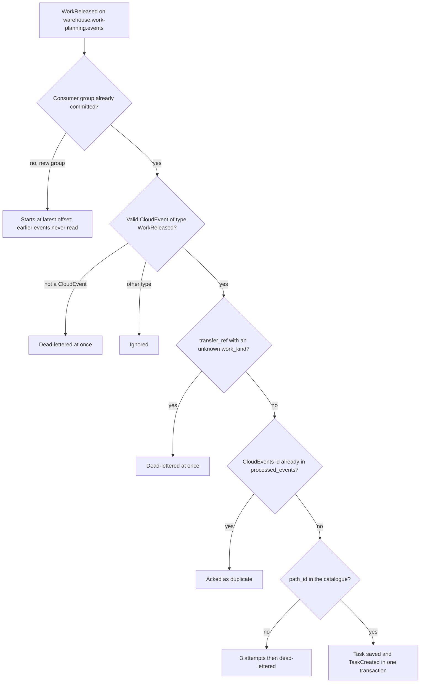

# Troubleshooting

Every row below comes from a code path in this repository: an error the
composition roots return, a problem type `internal/adapters/inbound/http/errors.go`
maps, or a branch in a consumer. Log messages are quoted exactly so you can
grep for them; the full list is on [Observability](./observability.md#logs).

## Boot and readiness

| Symptom | Cause | Check | Fix |
| --- | --- | --- | --- |
| `cmd/execution` exits with `failed to load the process-path catalogue` | `PATH_CATALOGUE_SOURCE` is `file` (the default) and `PATH_CATALOGUE_FILE` is missing, empty or invalid YAML. The file is a hard boot invariant. | `kubectl logs`; `pathCatalogue.enabled` and the ConfigMap; locally, the path you exported. | Mount a valid catalogue (warehouse-infra `config/process-paths/sortable-fc.yaml` works locally) or switch to `PATH_CATALOGUE_SOURCE=kafka`. |
| Exits with `process-path catalogue did not become ready within 1m0s` | `kafka` catalogue mode: the replay of `warehouse.process-path-management.events` did not reach the startup watermark in 60s. | Broker reachable from the pod? Topic exists and is readable? | Fix broker access. Since [ADR-0044](../adr/0044-listener-before-catalogue-replay.md) the listener is up during the wait, so `/healthz` keeps the startup probe satisfied and the pod reports this error itself instead of being killed by the probe; `/readyz` stays 503 until the replay catches up. |
| Exits with `failed to start the process-path Kafka catalogue` | The synchronous dial that captures the readiness watermark failed 5 times. | `KAFKA_BROKERS`; WARN `retrying` lines with `op=dial process-path kafka catalogue`. | Point `KAFKA_BROKERS` at the real broker (the binary default `localhost:9092` is wrong in a cluster). |
| Exits with `PRODUCT_CLASSIFICATION_MODE=http was removed (ADR-0039)...` | A stale deployment still sets the retired mode. | `PRODUCT_CLASSIFICATION_MODE` in the Deployment env. | Set `kafka` with `PRODUCT_CLASSIFICATION_CONSUMER_GROUP`, or `permissive`. |
| Exits with `PRODUCT_CLASSIFICATION_MODE=kafka requires PRODUCT_CLASSIFICATION_CONSUMER_GROUP` or `unknown PRODUCT_CLASSIFICATION_MODE` | Missing group or a typo. Checked before anything dials. | Env vars. | Set both, see [Configuration](./configuration.md). |
| Exits with `run migrations (after 5 attempts): ...` | Postgres unreachable for the whole boot-retry budget, or a migration failed. | The wrapped error. `Dirty database version N` means an earlier run failed half-way. | Restore connectivity; for a dirty version fix the SQL issue and `migrate ... force` (see [Runbook](./runbook.md#databases-and-migrations)). |
| Several replicas crash-loop at once with `pq: unnamed prepared statement does not exist` or `canceling statement due to statement timeout` during migrations | Migrations ran through PgBouncer in transaction-pooling mode, where golang-migrate's `pg_advisory_lock` does not hold ([ADR-0031](../adr/0031-migrations-direct-postgres-connection.md)). | Is `MIGRATIONS_DATABASE_URL` set and does it point at Postgres directly? | Add the `MIGRATIONS_DATABASE_URL` key to the database Secret. |
| Projector or reports exits with `ANALYTICS_DATABASE_URL is required` | Variable unset. | Analytics Secret and `analytics.database.*` values. | Provide the DSN (read-write for the projector, read-only for reports). |
| `/readyz` returns `503 {"status":"not_ready"}` | Either the pod received SIGTERM (readiness flips first during shutdown and never flips back), or, with `PATH_CATALOGUE_SOURCE=kafka`, the process-path catalogue replay has not caught up yet: the listener is up during the replay and `/healthz` already answers 200 ([ADR-0044](../adr/0044-listener-before-catalogue-replay.md)). | Pod is `Terminating`? Otherwise the log: `http listener up; /readyz stays not ready until the process-path catalogue has replayed its initial history` without a later `process-path catalogue is ready`. | Shutdown: nothing to fix. Warm-up: wait; it either turns ready or exits after 60s with `process-path catalogue did not become ready within 1m0s` (row above). A pod that never answers `/readyz` at all is still running migrations or the boot retries. |
| WARN `opentelemetry error ... connection refused` every few seconds | No Collector at `OTEL_EXPORTER_OTLP_ENDPOINT` (default `localhost:4317`). | Is a Collector running? | Harmless; start a Collector or ignore it locally. |

## REST problem types

Every error is `application/problem+json` with
`type = https://errors.fulfillment-execution.warehouse-systems.dev/<slug>`
([ADR-0005](../adr/0005-rfc-7807-problem-details.md)). This service returns
no `412`.

| Status and slug | Typical cause | Check | Fix |
| --- | --- | --- | --- |
| `400 invalid-request` | Malformed JSON, or a required field missing from the DTO. | `detail`. | Fix the request body against the [API Reference](../api-reference/index.md). |
| `400 idempotency-key-required` | `POST /tasks` without an `Idempotency-Key` header **while `DATABASE_URL` is set** (the middleware is not wired in memory mode). | Request headers. | Send a unique `Idempotency-Key` per new task ([ADR-0028](../adr/0028-idempotency-key-middleware.md)). |
| `422 idempotency-key-reused` | The same `Idempotency-Key` was used before with a different body (SHA-256 of the body differs). | `idempotency_keys` row for the key. | Use a new key for a genuinely different request. The same key with the **same** body is not an error: the stored response is replayed. |
| `404 station-not-found` | `claim-next`, check-in or check-out for a station that was never registered, or the process restarted in memory mode and lost it. | `GET /capacity/{capability}` counts registered stations. | `POST /stations` (re-registering is idempotent and updates capabilities). |
| `404 task-not-found` / `404 package-not-found` | Unknown id; in memory mode, a restart. | The id; `GET /tasks?orderRef=` or `GET /packages?orderRef=`. | Use an existing id. |
| `409 no-claimable-task` | No Pending (or lease-expired) task of that type whose required capabilities the station has. | `GET /queues/{taskType}/depth`; the task's `requiredCapabilities` vs the station's. | Release work, or register the station with the missing capability. |
| `409 task-not-claimed` | Renew, complete or seal on a task with no claim, or whose lease (5 minutes) has lapsed, even before a sweep frees it ([ADR-0038](../adr/0038-seal-package-expired-lease-is-not-claimed.md)). | `leaseExpiry` on the claim response. | Renew before expiry; after expiry claim again. |
| `409 task-not-owner` | Another station holds the active claim (the lease lapsed and the task was re-claimed). | `leaseStationId`. | The original station must stop work on that task. |
| `409 task-already-completed` / `409 task-already-claimed` | A retry after success, or a race lost. | Task status via `GET /tasks?orderRef=`. | Treat a repeated completion as done. |
| `409 station-occupied` / `409 station-not-occupied` | Check-in on an occupied station, check-out on an empty one. | The station's `occupied` flag in the check-in/out response. | Check out first / nothing to do. |
| `409 package-already-sealed`, `package-not-sealed`, `package-already-processed` | Seal twice, SLAM before seal, SLAM twice. | `GET /packages/{id}`. | Follow seal, then a single SLAM. |
| `409 package-segregation-violation` | Two scanned SKUs carry incompatible DOT hazard classes in the local classification copy ([ADR-0010](../adr/0010-package-segregation-and-sort-lane.md)). | `product_classification_copy` rows for the SKUs. | Split the items into separate packages. |
| `422 task-capability-mismatch`, `station-capability-mismatch` | Capabilities do not match the task's requirements. | Station vs task capabilities. | Register the right capabilities. |
| `422 wrong-task-type` | Seal on a task that is not `PACK`. | Task `type`. | Seal only PACK tasks. |
| `422 package-no-scanned-contents` | Seal with an empty `contents` list. | Request body. | Scan at least one item. |
| `422 rebin-unknown-line` | `POST /rebin/arrivals` with a `lineId` outside the order's `requiredLineIds`. | Request body. | Send the line set consistently for the order. |
| `422 relocation-confirmation-required` | `complete` on a RELOCATE task without `quantity` (and the open bin) ([ADR-0047](../adr/0047-relocate-tasks-execute-slot-plan-moves.md)). | The task's `relocation` on `GET /tasks?orderRef=`. | Send the operator's count and the scanned `fromBin` (Assign) or `toBin` (Vacate). |
| `422 invalid-relocation-confirmation` | The open side was not scanned, a scan differs from the planned bin, or both bins are equal. | `relocation.fromBin` / `toBin` vs the request. | Rescan; send only the open side, or the planned bin unchanged. |
| `422 not-relocation-task` | `quantity` / `fromBin` / `toBin` sent to a task that is neither RELOCATE nor REPLENISH. | Task `type`. | Drop the fields. |
| `422 replenishment-confirmation-required` | `complete` on a REPLENISH task without `quantity` ([ADR-0050](../adr/0050-replenish-tasks-execute-pick-face-replenishment.md)). | The task's `replenishment` on `GET /tasks?orderRef=`. | Send the operator's count (bins optional). |
| `422 invalid-replenishment-confirmation` | The quantity is below 1, or a scanned bin differs from the planned `replenishment.fromBin` / `toBin`. | `replenishment` vs the request. | Rescan, or omit the bins. |
| `422 station-location-not-workcenter` | `LOCATION_ROLE_MODE=http` and facility-layout says the `locationCode` is not a `WorkCenter`. | facility-layout `GET /locations/{locationCode}`. | Use a WorkCenter location. |
| `500 internal-error` with `statement timeout` in `detail` | A query held its connection for more than 5s (`statement_timeout`). | Postgres locks and load. | Find the blocking session; the pool is small (10). |

## Kafka, outbox and DLQ

| Symptom | Cause | Check | Fix |
| --- | --- | --- | --- |
| Released work never becomes a task | One of: the consumer group is new and started at the **latest** offset; the `path_id` is not in the catalogue (dead-lettered); the broker is unreachable. | Group offsets on `warehouse.work-planning.events`; `x-dlq-error` on the `.dlq` topic; WARN `kafka read failed; retrying`. | Re-release the work, define the path, or fix the broker. Replay procedure: [Runbook](./runbook.md#routine-procedures). |
| DLQ (`warehouse.work-planning.events.dlq`) growing | Handling failed 3 times, or the message is not a CloudEvent. | `x-dlq-error` header; ERROR `kafka message handling failed after retries`. | Fix the cause, then replay the original value. |
| RELOCATE work dead-lettered | wes-work-planning released RELOCATE work without `data.relocation`, or put it on another path, or sent an invalid move (missing `move_seq`, a kind other than `Relocate` / `Assign` / `Vacate`, a required bin missing) ([ADR-0047](../adr/0047-relocate-tasks-execute-slot-plan-moves.md)). | `x-dlq-error`: `without a relocation move`, `relocation move released on a non-RELOCATE path`, `invalid relocation move`, `unknown relocation kind`. | Fix the producer against the ADR-0047 contract, then re-release or replay. |
| REPLENISH work dead-lettered | wes-work-planning released REPLENISH work without `data.replenishment`, or put the object on another path, or sent an invalid move (a blank id, sku or bin, equal bins, a quantity below 1, a priority other than `NORMAL` / `URGENT`) ([ADR-0050](../adr/0050-replenish-tasks-execute-pick-face-replenishment.md)). | `x-dlq-error`: `without a replenishment move`, `replenishment move released on a non-REPLENISH path`, `invalid replenishment move`, `unknown replenishment priority`. | Fix the producer against the ADR-0050 contract, then re-release or replay. |
| DLQ entry with `x-dlq-error: context canceled` | Written by a build older than [ADR-0046](../adr/0046-workreleased-consumer-commits-after-settle.md): a healthy `WorkReleased` interrupted by a pod shutdown was dead-lettered. Current builds never do this. | `x-dlq-failed-at` matches a rollout/restart time. | Replay the original value; the processed-events claim makes it safe if the Task already exists. |
| Failures only in logs, no DLQ topic | `EVENT_PUBLISHER` is not `kafka`, so no DLQ writer is wired. | Env. | Expected in local/log mode. |
| Duplicate tasks after a restart | No `DATABASE_URL`: `processed_events` was in memory and is gone. | Env. | Run with Postgres anywhere redelivery matters. |
| Consumer lag on `warehouse.product-master.events` | A transient failure is being retried forever on one message; the partition is blocked. | ERROR `applying ProductClassified failed; retrying the same message`. | Fix the database problem; the consumer resumes on its own. |
| Downstream contexts never see `TaskCompleted` / `TaskCPTMissed` / `PackageManifested` | `EVENT_PUBLISHER=log`; or the relay is not running (it runs only in `cmd/execution`); or rows fail to send. | INFO `event publisher configured` (`publisher`, `mode`); `outbox_events` rows with `published_at IS NULL` and `last_error`. | Set `EVENT_PUBLISHER=kafka`; make sure the api Deployment runs; fix the broker. |
| One event never arrives while later ones (even for the same task) do | The row hit the outbox attempt cap ([ADR-0042](../adr/0042-outbox-relay-attempt-cap.md)) and is excluded from claims. | ERROR `outbox relay: row reached the attempt cap ...`; `SELECT id, attempts, last_error FROM outbox_events WHERE published_at IS NULL AND attempts >= 20;` | Fix the cause in `last_error`, then `UPDATE outbox_events SET attempts = 0 WHERE id = ...;`. Raise `OUTBOX_MAX_ATTEMPTS` (or set `0`) if broker outages trip it. |
| The same `TaskCPTMissed` arrives every 5 minutes | By design: the sweep re-publishes for every still-open overdue task on every pass, each with a new event id. | – | Consumers dedupe on their own business key. |
| `associate_id` missing on `TaskCompleted` | The station had no checked-in occupant at completion time (robots never check in). | `POST /stations/{stationId}/check-in` history. | Check the associate in. |

## Dependencies and analytics

| Symptom | Cause | Check | Fix |
| --- | --- | --- | --- |
| Stations with any `locationCode` are accepted | `LOCATION_ROLE_MODE` is `permissive` (the default and the kind cluster's setting), facility-layout is failing, or the breaker is open. While open, the client falls back to "unknown role", which is accepted. | `circuit_breaker_state{dependency="facility-layout"}` (`2` = open); `FACILITY_LAYOUT_BASE_URL`. | Fix facility-layout or the URL. The breaker opens after 5 consecutive failures, or more than half failing over at least 10 calls, and probes again after 30s. |
| Hazmat items sealed together without a `409` | `PRODUCT_CLASSIFICATION_MODE=permissive`, or the SKU is not in `product_classification_copy` yet (unknown means unclassified). | Env; `SELECT * FROM product_classification_copy WHERE sku = ...`. | Run in `kafka` mode; check the product-master consumer is current. |
| Throughput report empty or stale | `analytics.enabled=false`; the projector is down; the api runs `EVENT_PUBLISHER=log`; or history predates the deployment. A `PackageManifested` that cannot be matched to a SLAM task is skipped by design. | `GET /reports/throughput/freshness` (`lagSeconds`); projector logs. | Enable and run the projector; replay from earliest to backfill ([Runbook](./runbook.md#routine-procedures)). |
| `400 invalid-report-query` from `/reports/throughput` | `from`/`to` missing or not RFC 3339, or `granularity` other than `hour`. | Query string. | Send both bounds in RFC 3339. |

## MCP

| Symptom | Cause | Check | Fix |
| --- | --- | --- | --- |
| `get_fulfillment_throughput_report` / `get_on_time_to_cpt` missing from `tools/list` | `REPORTS_BASE_URL` unset. | INFO `fulfillment reports tool enabled` at boot. | Set it (the chart derives it when `analytics.enabled`). |
| Report tool returns an error starting `reports client:` | The reports service is down or returned non-2xx. | `curl` its `/healthz`. | Start `cmd/fulfillment-reports`. |
| Report tool call rejected before the handler runs | The SDK schema marks every argument required, including the optional filters. | `tools/list` input schema. | Pass `""` for unused filters (and `granularity`). |
| `unknown process path "REBIN": must be PICK, PACK or SLAM` | The MCP tools accept only those three paths. | – | Use REST `GET /queues/REBIN/depth`. |
| MCP and REST disagree about tasks | Both run without `DATABASE_URL`: each process has its own in-memory store. | Env of both processes. | Point both at the same database. |
| Session errors after scaling MCP | Sessions live in process memory and the Service has no affinity. | `mcp.replicaCount`. | Keep one replica. |
| Browser call to the REST API blocked by CORS | Origin not in `CORS_ALLOWED_ORIGINS`. | Browser console. | Add the origin (comma-separated). |

## Where released work can get lost

Source: `internal/adapters/inbound/kafka/consumer.go`,
`internal/application/usecases/consume_work_released.go`.
