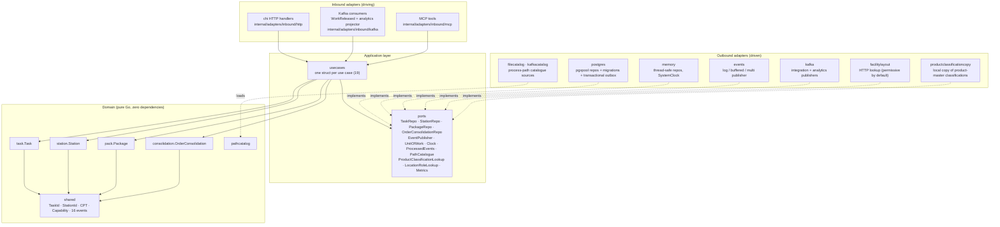
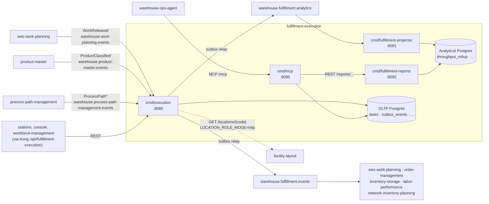

# Architecture

The service is **hexagonal (ports and adapters)**, and the dependency rule is
treated as non-negotiable:

> **Domain depends on nothing. Application depends on domain. Adapters depend
> on application and domain.** No framework or SQL type ever appears in the
> domain layer.



Source: the package layout under `internal/`, `internal/application/ports/ports.go`,
`internal/architecture/architecture_test.go`.

The analytics read side (`cmd/fulfillment-projector`,
`cmd/fulfillment-reports`, `internal/analytics/report`,
`outbound/analyticsstore`) follows the same layering against a separate
analytical database — see [Throughput report](../analytics/throughput-report.md).

Solid arrows are compile-time dependencies; dotted arrows are interface
implementations, which is where the arrows get inverted — the outbound
adapters depend on `ports`, never the reverse.

## Package map

```
cmd/execution/                 main.go — the OLTP composition root, the only place
                               that knows both a pgxpool and a use case exist
cmd/fulfillment-projector/     analytics WRITER: analytics topic -> analytical DB
cmd/fulfillment-reports/       analytics READ-ONLY reader: GET /reports/...
cmd/mcp/                       MCP server (Streamable HTTP)
internal/
  domain/
    task/                      Task aggregate (Pick|Pack|SLAM|Rebin lifecycle, lease, CPT-missed)
    station/                   Station aggregate (occupant, capabilities, locationCode)
    package/                   Package aggregate (seal, segregation, SLAM weigh-check)
    consolidation/             OrderConsolidation — Rebin fan-in tracker
    pathcatalog/               process-path catalogue model (prefix-match lookup)
    shared/                    TaskId, StationId, CPT, Capability, 16 domain events
  analytics/report/            analytical read model + store ports
  application/
    ports/                     OUT interfaces (see Use cases & ports)
    usecases/                  one struct per use case (19 of them)
  adapters/
    inbound/http/              chi router, handlers, DTOs, RFC 7807 error mapping
    inbound/kafka/             WorkReleased + ProductClassified consumers, analytics projector consumer
    inbound/mcp/               MCP tools (curated, governance-tested)
    outbound/postgres/         pgxpool repos + migrations + transactional outbox
    outbound/memory/           in-memory repos for tests and local runs
    outbound/events/           log / buffered / multi publisher
    outbound/kafka/            integration + analytics publishers
    outbound/analyticsstore/   analytical DB writer + read-only reader
    outbound/filecatalog/      process-path catalogue file loader
    outbound/kafkacatalog/     process-path catalogue Kafka replay
    outbound/productclassificationcopy/  local copy of product-master classifications (ADR-0039)
    outbound/facilitylayout/   facility-layout location-role lookup (opt-in)
  observability/               OpenTelemetry traces, metrics, slog
  architecture/                arch-go fitness tests (test-only package)
migrations/                    golang-migrate SQL files (+ migrations/analytics/)
apis/                          openapi.yaml + asyncapi.yaml (the published contracts)
features/                      Gherkin acceptance specs, run by godog
web/                           fulfillment-mfe Module Federation remote
charts/fulfillment-execution/  Helm chart
```

The `package` directory is imported as `pack` in Go, because `package` is a
reserved keyword — the aggregate is still called `Package` in the ubiquitous
language, and only the Go identifier bends.

## Binaries, ports and data stores

Four binaries are built from this module into one image (`/app/<name>`).
Each has its own composition root under `cmd/` and is deployed as its own
Kubernetes Deployment ([Runbook](../operations/runbook.md#deployment-shape)).

| Binary | Role | Listens on (default) | HTTP surface | Reads / writes |
| --- | --- | --- | --- | --- |
| `cmd/execution` | OLTP service: REST API, `WorkReleased` consumer, optional `ProductClassified` and process-path catalogue consumers, outbox relay | `HTTP_ADDR` `:8080` | every route in `apis/openapi.yaml`, incl. `/healthz` and `/readyz` | OLTP Postgres (read-write, runs migrations); Kafka in and out |
| `cmd/mcp` | MCP server over Streamable HTTP; same use cases over the same database | `MCP_ADDR` `:8090` | `/` and `/mcp` (MCP), `/healthz` | OLTP Postgres (runs migrations, writes `outbox_events` via `complete_task`); calls `cmd/fulfillment-reports` when `REPORTS_BASE_URL` is set |
| `cmd/fulfillment-projector` | Analytics **writer**: consumes `warehouse.fulfillment.analytics` and projects it | `ADMIN_ADDR` `:8091` | `/healthz` only | analytical Postgres (read-write, runs analytics migrations) |
| `cmd/fulfillment-reports` | Analytics **reader**: serves the throughput report | `HTTP_ADDR` `:8092` (chart: `:8080`) | `/reports/throughput`, `/reports/throughput/freshness`, `/healthz` | analytical Postgres over a read-only pool |

Data stores: one **OLTP** Postgres database (`tasks`, `stations`,
`packages`, `order_consolidations`, `processed_events`, `outbox_events`,
`idempotency_keys`, `product_classification_copy`, plus the unused
`domain_events` from migration 0001) and one separate **analytical**
Postgres database (`throughput_rollup`, `analytics_pending_claims`,
`analytics_processed_events`, `analytics_consumed_events`). Without
`DATABASE_URL`, `cmd/execution` and `cmd/mcp` each keep their state in
process memory.



Source: `cmd/execution/main.go`, `cmd/execution/classification.go`,
`cmd/mcp/main.go`, `cmd/fulfillment-projector/main.go`,
`cmd/fulfillment-reports/main.go`, `internal/composition/publisher.go`.
Who consumes which event is on [Integration contracts](../ecosystem/integration-contracts.md).

## The dependency rule is executable, not aspirational

`internal/architecture/` encodes the rule as real Go tests
using [arch-go](https://github.com/arch-go/arch-go) — the Go equivalent of
ArchUnit — plus a few source-scanning fitness functions. They run in the
`arch-test` CI job (`make arch-test`). The arch-go dependency subtests:

| Subtest | What it forbids |
| --- | --- |
| `domain has no internal dependencies except domain` | Any import from `internal/domain/**` into application or adapters |
| `application depends only on domain` | Application reaching for a concrete adapter |
| `inbound adapters do not depend on outbound adapters` | The HTTP layer talking to pgx directly |
| `outbound adapters do not depend on inbound adapters` | A repo importing an HTTP DTO |
| `only cmd wires every layer together` | Wiring leaking out of the composition root |
| `analytics imports nothing internal except analytics` | The analytics read model reaching into OLTP code |
| `domain and application do not import analytics` | The OLTP core depending on the analytics read side |
| `mcp adapter depends only on application and domain` | MCP tools reaching into other adapters |
| `nothing else depends on the mcp adapter` | Other packages importing MCP tool code |

The remaining fitness tests in the same package guard fleet rules rather
than layering: `TestRepositoryPortImplementersFollowRepoNamingConvention`,
`TestNoAuthMiddlewareReintroduced` (ADR-0022),
`TestKafkaConsumerGroupNeverHardcodedInline`,
`TestKafkaIntegrationTestsUseTestcontainers`, `TestCloudEventsOnly`
(ADR-0032), `TestReplayConsumersSetCommitInterval`, and
`TestEventCatalogueMatchesContract` / `TestEventCatalogueDetector` (the
published event catalogue matches `apis/asyncapi.yaml`).

Rationale and the alternatives considered are in
[ADR-0001](../adr/0001-hexagonal-ports-and-adapters.md) and
[ADR-0006](../adr/0006-arch-go-architecture-fitness-tests.md).

## Composition root

`cmd/execution/main.go` is the single place where concrete adapters are chosen,
entirely from environment variables:

- `DATABASE_URL` **unset** → in-memory repositories (`memory.NewTaskRepo()` and
  friends). This is why the service runs with a single `go run` and no
  infrastructure.
- `DATABASE_URL` **set** → migrations are applied via `golang-migrate`
  (over `MIGRATIONS_DATABASE_URL` when set, ADR-0031), then `pgxpool`
  repositories, a Postgres `UnitOfWork` and the `POST /tasks`
  `Idempotency-Key` middleware (ADR-0028) are wired.
- `EVENT_PUBLISHER=kafka` → `ports.EventPublisher` fans every domain event to
  the integration encoder (`TaskCompleted`, `TaskCPTMissed`,
  `PackageManifested` → `warehouse.fulfillment.events`) and the analytics
  encoder (→ `warehouse.fulfillment.analytics`). With Postgres the encoded
  messages are written to `outbox_events` inside the use case's own
  transaction and drained by an in-process relay (ADR-0020); without
  Postgres they go straight to the broker. The default is the log
  publisher. The same interface backs all of them, so no use case knows
  which one it got. The wiring is shared with `cmd/mcp` through
  `internal/composition`.
- The process-path catalogue comes from `PATH_CATALOGUE_SOURCE`: `file`
  (default, `PATH_CATALOGUE_FILE`) or `kafka` (replays
  `warehouse.process-path-management.events`, ADR-0017).
- The `WorkReleased` Kafka consumer always starts, reading
  `warehouse.work-planning.events` from `KAFKA_BROKERS`; its dead-letter
  writer (`<topic>.dlq`) is wired only when `EVENT_PUBLISHER=kafka`.
- `PRODUCT_CLASSIFICATION_MODE=kafka` adds the `ProductClassified` consumer
  and the local classification copy (ADR-0039); `LOCATION_ROLE_MODE=http`
  swaps the permissive location-role lookup for the facility-layout client
  behind a circuit breaker (ADR-0024, ADR-0029). Every variable is on
  [Configuration](../operations/configuration.md).

Every use case receives its dependencies as struct fields — there is no DI
container, no service locator, and no global state.

## Read models are projections

Queue depth (`GET /queues/{taskType}/depth`) is computed from task state via
`TaskRepo.CountByTypeAndStatus`, not stored as a counter on an aggregate. The
same discipline applies to any throughput metric: read models are
**projections**, never denormalised fields that can drift from the facts that
produced them.
